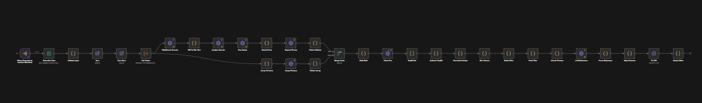

# SEO Keyword Gap Analysis Pipeline (n8n & OpenAI)

An automated high-throughput data analysis engine that identifies commercial keyword gaps against competitors using Senuto APIs, custom JavaScript data processing, and LLM relevance evaluation.

## Visual Architecture

## Core Workflow Steps
1. **Input Normalization:** Sanitizes input domains and competitor lists using custom JS.
2. **Dynamic Domain Research:** Conducts live web research via OpenAI web search to extract the client's business niche and commercial profile.
3. **Data Harvesting & Expansion:** Queries Senuto APIs for related keywords and competitor positioning with full pagination and batching controls.
4. **Data Aggregation & Deduplication:** Normalizes search volume, strips diacritics, groups semantic duplicates, and filters out terms already in the client's Top 50 rankings.
5. **Deterministic Entity Filter:** Evaluates thousands of phrases against cached entity lists (cities, streets, personal names, brands) to strip non-commercial keywords before LLM ingestion.
6. **LLM Relevance & Export:** Chunks surviving phrases into batches for GPT-4o validation, generating a final sorted CSV report.

## Technical Highlights
* **Global Static Data Cache:** Uses `$getWorkflowStaticData('global')` to persist entity whitelists and API error states across executions.
* **Cost-Optimization Architecture:** Cuts LLM token usage by filtering with regex rules and volume thresholds before the OpenAI calls.
