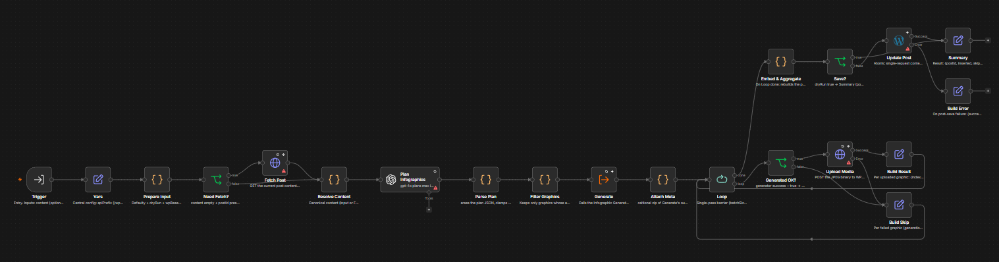

# Autonomous Infographics Pipeline with Vision Quality Control (n8n & LangChain)

A modular multi-agent workflow that scans WordPress articles, designs contextual vector infographics, handles image generation, conducts vision-based QA, and updates content automatically.

## Visual Architecture

## Core Workflow Steps
1. **Content Fetch & Analysis:** Pulls raw post HTML via WordPress REST API and uses GPT-4o to plan up to 3 context-specific vector infographics with exact heading anchors.
2. **Parent-to-Sub-workflow Execution:** Iterates over graphics via `splitInBatches` and triggers the generator sub-workflow.
3. **Automated Image Generation:** Formulates detailed prompts enforcing flat vector styling and correct Polish typography.
4. **Vision Quality Control (AI-QC):** Uses GPT-4o Vision to inspect the rendered image for blurry text, spelling issues, or truncated layouts, triggering up to 2 retries on failure.
5. **Media Upload & Content Insertion:** Uploads validated JPEG assets to the WordPress media library and cleanly replaces old SVG tags or inserts `<figure>` elements after heading anchors.

## Technical Highlights
* Robust Parent-Child workflow decoupled execution pattern.
* Self-correcting retry loop appending QC failure reasons to subsequent generation prompts.
